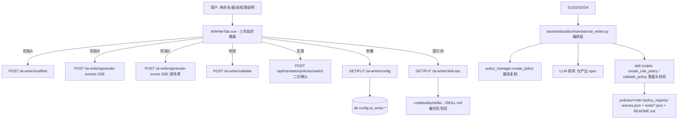

## 产品概述

在 ClawAVC 策略翻译模块（`/policy` 页面）新增独立的「AI帮写」子 Tab，用「skill + workflow」组合的方式，让 AI 依据用户的自然语言指令自动生成符合通用格式规范的角色策略库（policies），并保证产物格式统一、结构完整、可后续调整。

## 核心功能

1. **三阶段分步生成（每步可见、可编辑、可重跑，确认后进入下一步）**

- 阶段 A（workflow）：输入角色名 + 基线（default/ops）+ 权限说明 → 创建基础目录结构 `policies/<role>/policy_registry/`（基线只读复制），展示产出文件清单。
- 阶段 B（AI 生成场景）：AI 依据用户指令输出场景清单（`scenes.json` 的增删决策与理由）→ 表格/JSON 可编辑、可重跑 → 确认写盘。
- 阶段 C（AI 填充内容）：逐场景由 AI 按用户提示填充 `tools/*.json` 约束（文件读写范围、网络域名、Bash 命令白/黑名单与 workdir）→ 每场景可单独重生成、可手工改、可回滚基线版本 → 确认写盘。

2. **格式与结构保障**：AI 只产出「权限意图（spec）」，落盘与适配由既有 skill 脚本执行（deny-wins、基线适配、scenes↔tools 一致性）。
3. **收尾与后续调整**：校验（E 级阻断 / W 级提示）+ 变更清单 diff + 角色 README；切换生效需二次确认（热重载）；生成后仍可编辑单文件、单场景重生成、随时重校验。
4. **独立 AI 参数抽屉**：超大 drawer，配置 API Token（不回显、空值不覆盖）、Base URL、Model（含 temperature/timeout）、以及**可在线编辑的 SKILL.md 本体**（写前备份、可恢复默认）；配置独立存储，不影响翻译模块自身模型。

## 约束（已确认）

- 产物只落在新建角色目录，绝不修改 `default`/`ops` 及任何既有角色。
- 角色名匹配 `^[A-Za-z0-9_-]{1,64} 且不得为 `default`/`ops`。
- AI 参数独立一套存储，与「模型配置」Tab 互不影响。

## 技术栈（沿用现有项目）

- 后端：Python 3 + Flask（`backend/app.py`），配置持久化 `db.get_config/set_config`，热重载 `policy_manager._reload()`
- 前端：Vue 3 + TDesign（`t-tabs` / `t-steps` / `t-drawer` / `t-table` / `t-textarea`），Vite dev server（15101）
- 流式：`text/event-stream` SSE（`stream_with_context`，照 `backend/xy_skill.py` 与 `app.py` L1588-1632 范式）
- Skill 资产：`.codebuddy/skills/clawavc-policy-creator/`（`SKILL.md`、`scripts/create_role_policy.py`、`scripts/validate_policy.py`、`references/policy_schema.md`、`references/role_playbook.md`）

## 实现方案

### 核心策略：**AI 只生成 spec，落盘交给 skill 脚本**（单一事实来源）

避免后端重写一套适配逻辑造成格式漂移：

- AI 产物 = 结构化 spec（`role_name/base_policy/title/files/network/bash/scenes/no_git`）与场景增删决策；
- 落盘/适配 = 复用 skill 脚本内的 `apply_bash_spec / apply_files_spec / apply_network_spec / apply_scenes_spec / validate`，通过 `importlib` 从绝对路径加载 `.codebuddy/skills/clawavc-policy-creator/scripts/*.py`，后端仅做编排、校验与 API 暴露。
- 这样天然满足 skill 硬约束：基线只读、deny-wins、`static` dict/list 双兼容、`scenes.json + tools/` 齐备。

### 三阶段落地映射

| 阶段 | 实现 | 复用 |
| --- | --- | --- |
| A 建目录 | `policy_manager.create_policy(name, src=<base>)`（已实现 `shutil.copytree` 基线复制 + 重名拒绝 + `_reload`）；额外写 `README.md` 草稿与阶段快照 | 现有 `policy_manager.py` L196-223 |
| B 生成场景 | LLM（json_mode）输出 `{keep/disable/add, reason}` → 校验场景名必须存在于基线场景集 → 写 `scenes.json` 并同步 tools 文件 | skill `_disable_scene` / `apply_scenes_spec` |
| C 填充内容 | LLM 逐场景输出 spec 补丁 → 合并为完整 spec → 调 skill 适配函数落盘 → 每个场景结果缓存，支持单场景重生成 | skill `apply_*` + `validate_policy.py` |


### 关键设计决策

1. **SSE 流式**：沿用 `xy_skill.py` 事件模型（`stage / tool_call / text / text_done / done / error`），阶段进度与 AI 文本实时回显；失败给出可操作错误（未配置模型/JSON 解析失败/校验不通过）。
2. **LLM 输出可靠性**：`json_mode` + 提示词内嵌 `policy_schema.md` 要点 + 解析失败自动重试 1 次 + 手写 schema 校验（不引入新依赖）+ 非法值裁剪；温度默认 0.0 保证确定性。
3. **安全边界**：所有写操作路径必须位于 `policies/<role>/**` 之内（前缀白名单校验，重写前 `os.path.realpath` 归一），对 `default`/`ops` 一律拒绝；`api_key` 不回显、日志脱敏、PUT 需 `X-Admin-Session`（照 `/api/translator/config`）。
4. **原子写与可回滚**：写盘用「tmp + `os.replace`」；每阶段保存基线快照，支持「回滚本阶段 / 回滚到基线」；`SKILL.md` 写前备份 `.bak-<ts>` 并提供「恢复默认」。
5. **性能**：逐场景生成串行（避免乱序与配额抖动），单场景 LLM 超时可配（默认 120s），场景级结果缓存使重跑只重算目标场景；15 个场景全量生成耗时主要受 LLM 往返支配（每场景 1 次调用），UI 用流式进度条避免假死。

## 实现要点（防回归）

- 新增模块不得改动 `core.py::_static_spec / normalize_ir / _apply_static_deny` 语义；新增路由挂在 `/api/translator/ai-writer/*`，不动既有 `/api/translator/config`、`/policies/*`。
- `db` 配置键统一前缀 `ai_writer.*`（不复用 `ir_translator.*`）。
- 前端只在 `PolicyPage.vue` 增一个 `t-tab-panel` 与 import，其余 6 个 Tab 零改动。
- 收尾必须跑 `cd test && python3 run_tests.py`，现有 118 条须全绿。

## 架构设计



## 目录结构

```
backend/auditor/translator/
├── ai_writer.py                     # [NEW] 编排层：配置读写(ai_writer.*)、SKILL.md 读写与备份、
│                                    #       scaffold/生成场景/生成场景内容/校验/回滚；通过 importlib
│                                    #       复用 skill scripts，路径白名单限制在 policies/<role>/**
├── policy_manager.py                # [MODIFY] 仅小改：暴露基线场景清单读取（供阶段B 可选场景集），
│                                    #          不改动 create/switch/rename 既有语义
└── policies/<role>/                 # [RUNTIME 产物] policy_registry/{scenes.json, tools/*.json}, README.md

backend/app.py                       # [MODIFY] 新增 /api/translator/ai-writer/* 路由组：
                                     #   GET/PUT config（api_key 不回显、空值不覆盖、需特权）
                                     #   GET/PUT skill-doc（SKILL.md 读写，写前 .bak-<ts>）
                                     #   POST scaffold / generate-scenes / generate-scene（SSE）/ validate / rollback
                                     #   POST test（连通性自检，复用 /api/translator/test 风格）
                                     #   另在 api_docs 注册接口说明

frontend/src/views/policy/
├── AiWriterTab.vue                  # [NEW] 三阶段主界面：t-steps 步骤条 + 阶段输入 + 结果面板
│                                    #       （场景表格/工具 JSON 编辑器）+ 单场景重生成 + 校验结果 + 切换确认
└── AiWriterConfigDrawer.vue         # [NEW] 超大 t-drawer：API Token / Base URL / Model / temperature /
                                     #       timeout / SKILL.md 全文编辑器 + 测试连接 + 保存 + 恢复默认

frontend/src/views/PolicyPage.vue    # [MODIFY] 新增 <t-tab-panel value="ai-writer" label="AI帮写"> 与组件 import

test/test_module8_ai_writer.py       # [NEW] 覆盖：配置脱敏与空值不覆盖、SKILL.md 备份写回与恢复、
                                     #       scaffold 不触碰基线、非法角色名拒绝、spec schema 校验、
                                     #       deny-wins 落盘结果、validate E/W 分级、回滚正确性
```

## 关键结构（阶段产物契约）

```
// 阶段B：AI 场景决策
{ "keep": ["shell_exec", "file_ops"], "disable": ["im_chat", "email"],
  "add": [], "reason": { "im_chat": "角色无即时通讯诉求" } }

// 阶段C：AI 场景内容补丁（合并进 spec 后由 skill 落盘）
{ "scene": "file_ops",
  "files": { "read_paths": ["/data/**"], "write_paths": [], "deny_paths": ["/etc/**"] },
  "network": { "enabled": false },
  "bash": { "mode": "replace", "allowed_commands": ["ls","cat","grep"],
            "denied_commands": ["rm","curl"], "workdir_allowlist": ["/workspace/**"] } }

// SSE 事件（沿用 xy_skill 风格）
{ "type": "stage|tool_call|text|text_done|done|error", "stage": "B", "data": {}, "message": "" }
```

## 设计风格

沿用项目既有的 TDesign 企业控制台风格，与其余 6 个策略 Tab 视觉一致；交互形态参考 `AnomalyChatPage.vue` 的「AI 对话流 + 独立配置弹窗」范式，以**三阶段步骤条（t-steps）为主线 + 右侧结果面板**的布局呈现，配流式打字动效、阶段切换过渡、hover 高亮与微动效，保持专业克制、留白充足。

## 页面规划（单页：策略翻译 → AI帮写 子 Tab）

- **B1 顶部步骤条区**：`t-steps` 三阶段（① 建目录结构 ② AI 生成场景 ③ AI 填充内容 ④ 校验生效），当前阶段高亮，已完成阶段可点击回退编辑；右侧「AI 参数」按钮打开超大抽屉。
- **B2 阶段输入区**：左侧输入卡片——阶段 A 为角色名/基线下拉/权限说明文本域；阶段 B/C 为对用户的补充提示输入；底部主按钮（生成 / 重跑 / 确认并进入下一步），按钮带加载态与流式进度条。
- **B3 结果面板区**：右侧主区域——阶段 A 展示生成的文件树清单；阶段 B 为场景表格（勾选保留/禁用 + 理由列，支持行内编辑与全选）；阶段 C 为场景卡片列表（每卡片含「重生成 / 编辑 JSON / 回滚基线」操作 + diff 折叠面板）。
- **B4 底部校验与生效区**：校验结果（E 级红色阻断、W 级橙色提示，可展开明细）、变更清单 diff、README 预览、「切换生效」二次确认按钮（危险操作用橙色警示样式）。
- **B5 独立配置抽屉（超大）**：`t-drawer` 宽约 720-880px，分区表单——连接参数（Base URL / Model / API Token 密码框脱敏 + 温度/超时高级折叠）、「测试连接」按钮与结果反馈、SKILL.md 全文编辑器（等宽字体、行号感、字数统计、「恢复默认」与「保存」双按钮，保存前提示将备份原文件）。

## 响应式与状态

桌面端优先，窄屏时结果面板转为纵向堆叠；所有异步阶段统一三态（加载/空态/错误态）与骨架屏，错误给出可操作提示（未配置模型 → 一键打开抽屉）。

## Agent Extensions

### Skill

- **clawavc-policy-creator**
- Purpose: 作为「AI帮写」的领域知识与落盘执行来源——复用其 `references/policy_schema.md`（spec schema）、`references/role_playbook.md`（权限说明→spec 映射与常见修复）、`scripts/create_role_policy.py` 的适配函数与 `scripts/validate_policy.py` 的校验规则，确保 AI 生成的策略符合通用格式与 deny-wins 裁决。
- Expected outcome: 后端不重复实现适配逻辑，AI 仅输出 spec，落盘与校验由 skill 资产统一执行，产物结构完整、格式与既有策略库一致。
- **测试专家**
- Purpose: 为 `test/test_module8_ai_writer.py` 设计测试策略与用例（等价类/边界值/异常流/安全边界），覆盖配置脱敏、基线只读、schema 校验、回滚与校验分级。
- Expected outcome: 形成可执行的测试套件并纳入 `test/run_tests.py`，与现有 118 条用例一起通过。