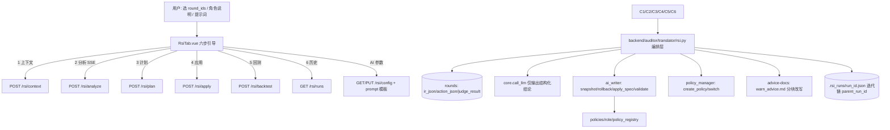

## 产品概述

在策略翻译模块新增独立的「RSI 自进化」子 Tab 与独立 AI 配置界面：以选定的历史 round_id 为样本，AI 读取这些 round 的真实数据（user_query、IR、行为 action、判定结果与得分），结合用户填写的「角色说明」与「用户提示词」进行综合分析，判断**哪些内容存在越权风险**、**哪些策略应适当放宽**，并给出**策略改造方向与具体字段级建议**；人工评审勾选后落到新建角色策略库，形成「数据 → 分析 → 改造 → 回测 → 反馈」的可持续自进化闭环。

## 核心功能

1. **样本选择**：按时间 / 是否异常 / 关键字 / round_id 检索并多选 round；填写角色说明与用户提示词（作为 AI 分析输入）。
2. **上下文汇聚**：后端聚合每个 round 的 user_query、ir_json、action_json、judge_result、overall_score、is_abnormal，并附加当前策略库摘要（scenes 清单、相关 tools 的 allowed_values/denylist/allowlist、引导文档分块）。
3. **AI 综合分析（SSE 流式）**：输出结构化结论——`risks`（越权风险项）、`relax`（应放宽项）、`transform`（策略改造项：目标文件 / 字段路径 / 现值→建议值 / 理由 / 风险等级）、`summary`、`assumptions`。
4. **人工评审与变更计划**：三类结论分栏卡片，逐条可勾选、可编辑、可丢弃；生成结构化 diff（指向具体文件与字段）。
5. **安全应用**：产物落到新建角色库 `policies/<role>/`（基线 default/ops 只读复制），落盘前快照、支持回滚，应用后重新校验（E 级阻断 / W 级提示）；引导文档类建议改写 warn_advice.md 分块。
6. **可选回测 + 迭代归档**：开关控制，对同一批 round 对比改动前后的 overall_score / 是否异常 / 维度失分项；每次进化保存轮次记录（含 parent_run_id），历史可查看、可对比、可基于上一轮发起下一轮。

## 范围约束（已确认）

- 进化作用域：**仅策略库内容**（scenes.json / tools/*.json / warn_advice 引导文档），**不改翻译提示词**（Level-1/Level-2、registry_prompt_format）。
- 产物落点：**新建角色库，可切换生效**，不影响当前生效库。
- 回测：**可选开关**，由用户决定是否触发。
- 触发：**手动触发 + 迭代历史可追溯**。
- AI 参数与 Prompt：**独立配置、可编辑**。

## 技术栈（沿用现有项目）

- 后端：Python 3 + Flask（`backend/app.py`），配置持久化 `db.get_config/set_config`（键前缀 `rsi.*`），SSE `text/event-stream`，判定复算 `auditor/monitor/judge.py`。
- 前端：Vue 3 + TDesign（`t-tabs/t-steps/t-drawer/t-table/t-tag/t-textarea`），Vite dev server 15101。
- LLM 调用：复用 `auditor/translator/core.py::call_llm(system, user, config, max_retry)`（OpenAI 兼容协议，json_mode 输出）。
- 安全落盘：复用 `auditor/translator/ai_writer.py`（snapshot / rollback / apply_spec / validate）与 `policy_manager.py`（create_policy / switch / _reload）。

## 实现方案

**核心策略：AI 只产出「结构化结论」，落盘交给既有 skill 与 ai_writer 编排层**——避免重写适配逻辑造成格式漂移，天然满足 deny-wins、基线只读、路径白名单。

**六步自进化闭环（一次进化 = 一条 evolution run）：**

1. 选样本（round_ids + 角色说明 + 用户提示词）
2. 汇聚上下文（round 明细 + 策略库摘要 + 可选上一轮回测反馈）
3. AI 分析（SSE 流式，schema 校验 + 非法项裁剪 + 解析失败纠正重试 1 次，温度默认 0）
4. 人工评审（三类结论勾选/编辑 → 变更计划 diff）
5. 应用（新建角色库 → 按采纳项落盘 → 快照/回滚 → 校验）
6. 可选回测 + 归档（轮次记录含 parent_run_id，形成迭代链）

**回测实现（分层，默认低成本路径）**：

- 低成本：对 round 的 `ir_json` 过一遍新策略的静态拒绝 `core._apply_static_deny` 得到「进化后 IR」，再 `judge(actions, evolved_ir)` 取 `overall_score`；与库内原 `overall_score`/`is_abnormal` 对比。
- 高保真（可选开关）：重新走一次翻译生成新 IR 再判定（消耗 LLM，显式开关、单轮上限）。

**性能与可靠性**：上下文按 round 裁剪（ir_json/action_json 超长截断 + 摘要化），单次分析 1 次 LLM 调用；轮次记录 JSON 落盘（tmp + `os.replace` 原子写）；LLM 超时可配（默认 120s）；回测串行执行并按 round 缓存结果。

## 实现要点（防回归）

- 不改动 `core.py::_static_spec / normalize_ir / _apply_static_deny` 与 `judge.py` 既有语义；新增 `rsi.py` 与路由为主。
- 配置前缀 `rsi.*`，与 `ai_writer.*`、`ir_translator.*` 互不干扰；GET 不回显 api_key，空值不覆盖，写操作需 `X-Admin-Session`。
- 写路径必须位于 `policies/<role>/**`（realpath 前缀校验）；角色名 `^[A-Za-z0-9_-]{1,64} 且非 `default`/`ops`。
- 产物应用遵循 deny-wins：新增拒绝项并入 `denylist` 并从 `allowed_values` 移除同串项。
- 前端仅在 `PolicyPage.vue` 增一个 `t-tab-panel` 与 import，其余 Tab 零改动。
- 收尾跑 `cd test && python3 run_tests.py`，现有 152 条须全绿，并新增 RSI 模块测试。

## 架构设计



## 目录结构

```
backend/auditor/translator/
├── rsi.py                      # [NEW] 编排层：配置(rsi.*)/prompt 模板读写、round 上下文汇聚、
│                               #       AI 分析(schema 校验+重试)、变更计划、应用(复用 ai_writer)、
│                               #       回测(judge 复算)、轮次归档与历史对比
├── .rsi_runs/                  # [RUNTIME] 进化轮次记录 run_id.json（含 parent_run_id）
├── ai_writer.py                # [MODIFY 最小] 仅暴露复用入口，不改既有语义
backend/app.py                  # [MODIFY] 新增 /api/translator/rsi/* 路由组：
                                #   GET/PUT config（api_key 不回显、空值不覆盖、需特权）
                                #   GET/PUT prompts（分析/放宽/改造 三类 Prompt 模板）
                                #   POST context（聚合 round + 策略摘要）
                                #   POST analyze（SSE：stage/text/done/error）
                                #   POST plan（按采纳项生成结构化 diff）
                                #   POST apply / rollback / validate
                                #   POST backtest（可选开关）
                                #   GET runs / GET runs/<id> / POST runs/<id>/next（基于上一轮迭代）
backend/api_docs.py             # [MODIFY] 登记 RSI 接口说明
frontend/src/views/policy/
├── RsiTab.vue                  # [NEW] 六步自进化主界面
└── RsiConfigDrawer.vue         # [NEW] 超大抽屉：AI 参数 + 三类 Prompt 模板编辑 + 测试连接
frontend/src/views/PolicyPage.vue # [MODIFY] 注册「RSI 自进化」子 Tab
test/test_module9_rsi.py        # [NEW] 单元测试
backend/auditor/translator/RSI_README.md  # [NEW] 流程、字段、限制说明
```

## 关键结构（契约）

```
// 进化轮次 run_id.json
{ "run_id": "rsi-20261014-0001", "parent_run_id": "",
  "created_at": "2026-10-14 10:00:00", "role": "analyst_evolved", "base": "default",
  "round_ids": ["c0b5183f", "27406217"], "role_desc": "只读数据分析师",
  "user_prompt": "重点收紧文件写入，放宽只读查询",
  "ai_result": { "risks": [], "relax": [], "transform": [], "summary": "", "assumptions": "" },
  "adopted": [], "applied": { "changes": [], "validation": {} },
  "backtest": { "enabled": true, "items": [
      { "round_id": "c0b5183f", "before_score": 0.66, "after_score": 1.0,
        "before_abnormal": true, "after_abnormal": false } ] },
  "status": "applied" }

// AI 结论条目（schema 校验后裁剪）
risks[]     = { round_id, scene, tool, param, behavior, violation, severity, action }
relax[]     = { round_id, scene, tool, blocked_behavior, reason, action }
transform[] = { target, path, current, proposed, reason, risk_level }

// SSE 事件（沿用 xy_skill 风格）
{ "type": "stage|text|done|error", "stage": "analyze", "data": {}, "message": "" }
```

## 设计风格

沿用项目既有的 TDesign 企业控制台风格（与其余 7 个策略 Tab 视觉一致）：浅灰底 #F5F7FA + 白色卡片、蓝色主色 #0052D9、克制的留白与 8px/12px 圆角，仅用语义色（绿=通过/放宽、红=越权风险、橙=需人工确认）做状态区分，避免装饰性动效。交互形态照搬已验证的「AI帮写」范式：顶部说明 Hero + 步骤条 + 右侧结果面板 + 独立超大抽屉。

## 页面规划（单页：策略翻译 → RSI 自进化 子 Tab）

- **B1 顶部说明与入口**：Hero 卡片说明自进化闭环（数据→分析→改造→回测→反馈），右侧「AI 参数」按钮打开 860px 抽屉；下方六步 `t-steps`（选样本 / 上下文 / AI 分析 / 评审 / 应用 / 回测归档），已完成步骤可点回退。
- **B2 样本选择区**：round 检索（时间范围、仅异常、关键字、round_id），结果表格多选（显示 round_id、时间、user_query 摘要、得分、是否异常），下方输入角色说明与用户提示词。
- **B3 上下文与 AI 分析区**：左侧上下文摘要（参与 round 数、命中场景、策略库摘要折叠面板），右侧 AI 分析区（SSE 流式文本 + 进度），分析完成后展示三类结论分栏（风险/放宽/改造），每条含严重度标签、理由、可勾选与编辑。
- **B4 变更计划与应用区**：按勾选生成结构化 diff 表（目标文件 / 字段路径 / 现值 → 建议值 / 风险等级），提供「新建角色库并应用」「回滚」「校验」按钮，校验结果按 E 级红、W 级橙分组展示。
- **B5 回测与迭代历史区**：回测开关与执行按钮，结果对比表（round、改动前得分/异常、改动后得分/异常、涨跌）；历史列表按时间倒序，显示 parent_run_id 迭代链，可查看详情、对比相邻轮次、基于某轮发起下一轮进化。
- **B6 独立 AI 配置抽屉**：Base URL / Model / API Token（密码框、脱敏显示、留空不改）/ 温度 / 超时 + 测试连接；三类 Prompt 模板（分析总纲、放宽判定、改造建议）编辑器，支持保存与恢复默认。

## 响应式与状态

桌面端优先，窄屏时结果面板纵向堆叠；所有异步阶段统一三态（加载/空态/错误态），错误给出可操作提示（未配置模型 → 一键打开抽屉）。

## Agent Extensions

### Skill

- **clawavc-policy-creator**
- Purpose：作为「策略改造」落盘与格式一致性的来源——复用其 spec 构造、`apply_*` 适配函数与 `validate_policy` 校验规则，确保 RSI 采纳的改造项生成符合通用格式的角色策略库。
- Expected outcome：RSI 不重复实现适配逻辑，产物结构完整、符合 deny-wins 与基线只读约束。
- **测试专家**
- Purpose：为 `test/test_module9_rsi.py` 设计测试策略与用例（等价类/边界值/异常流/安全边界），覆盖配置脱敏、上下文聚合、schema 校验与裁剪、应用与回滚、回测对比、轮次归档链路。
- Expected outcome：形成可执行测试套件并纳入 `test/run_tests.py`，与现有 152 条用例一起通过。