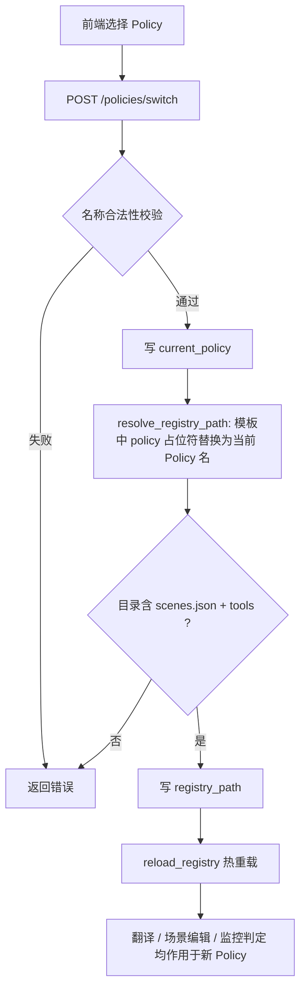

## 产品概述

将当前「单一通用策略库」升级为「可跨多套 Policy 的策略库体系」。前端可配置并切换当前使用的 Policy，系统按所选 Policy 读取对应的策略库；各 Policy 的场景集合相同（当前 15 个场景），差异在具体策略内容与参数约束。

## 核心功能

- **多 Policy 目录约定**：统一父目录 `policies/`，每个 Policy 一个子目录，子目录内固定为 `policy_registry`（保持现有「路径必须以 policy_registry 结尾」的校验不变），内含 `scenes.json` + `tools/`。
- **路径模板（动态占位符）**：路径中代表不同 Policy 的目录段用动态符 `{policy}` 代替，例如 `<backend>/auditor/translator/policies/{policy}/policy_registry`；切换 Policy 时将占位符替换为当前 Policy 名得到真实路径。
- **当前 Policy 配置与切换**：前端下拉选择当前使用的 Policy，切换**免特权**（普通登录用户可切换，便于快速对比不同策略效果），切换后立即热重载生效，无需重启服务。
- **Policy 全套管理（写操作需特权）**：支持新建、复制、重命名、删除 Policy；复制可保证新 Policy 与源的场景完全一致。
- **编辑作用于当前 Policy**：场景描述、函数新增/编辑/删除等既有能力保持不变，但自动作用于当前选中的 Policy。
- **安全与一致性校验**：Policy 名安全校验（防路径穿越）、目录结构校验、禁止删除/重命名正在使用的 Policy、禁止删除最后一个 Policy、列出时展示各 Policy 场景数以便发现场景差异。

## 技术栈

沿用现有项目栈：后端 Flask + SQLite（`config` 表），前端 Vue3 + Vite + TDesign Vue Next。不引入新依赖。

## 实现方案

核心思路：**新增一个 Policy 管理层（policy_manager）统一管理多套策略库，解析出的真实路径仍写入现有 `ir_translator.registry_path`，从而完全复用 core 与 registry-health 的既有逻辑与校验**，做到对现有链路零破坏、改动集中可控。

### 1. 配置键设计（SQLite config 表，前缀 `ir_translator.`）

| 键 | 含义 | 默认 |
| --- | --- | --- |
| `registry_path_template` | 路径模板，含 `{policy}` 动态占位符 | `<backend>/auditor/translator/policies/{policy}/policy_registry` |
| `current_policy` | 当前生效的 Policy 名 | `default` |
| `registry_path` | **解析后的真实路径**（保持现有语义，core 与 registry-health 继续以此为准） | 由模板+当前 Policy 解析得到 |


关键点：`registry_path` 仍是单一事实来源，切换 Policy 时由 policy_manager 重新解析并覆写，随后调用既有的 `reload_registry()` 热重载。

### 2. 目录迁移

将现有 `backend/auditor/translator/policy_registry` 迁移为 `backend/auditor/translator/policies/default/policy_registry`（内容原样不变），并把已配置的 `ir_translator.registry_path` 归一指向新位置；`core._DEFAULT_REGISTRY_DIR` 同步更新，保留「目录不存在时回退默认目录」的兜底。

### 3. 后端分层

- 新建 `backend/auditor/translator/policy_manager.py`：负责模板读写、当前 Policy 读写、路径解析、列出、切换、新建/复制/重命名/删除与全部校验。app.py 仅做路由转发与鉴权，避免主文件进一步膨胀（app.py 已 1300+ 行）。
- `core.py` **最小改动**：仅更新默认目录常量与回退逻辑，`_get_registry_dir()` 继续以 `registry_path` 为准，`reload_registry()` 原样保留。

### 4. 新增 API（均挂 `/api/translator/`）

| 方法 | 路径 | 说明 | 权限 |
| --- | --- | --- | --- |
| `GET` | `/policies` | 列出全部 Policy（名/路径/场景数/健康状态）+ 当前 Policy + 路径模板 + 解析后真实路径 | 普通 |
| `POST` | `/policies/switch` | 切换当前 Policy（解析→写 `registry_path`→reload） | **普通（免特权）** |
| `POST` | `/policies/create` | 新建 Policy（`from` 为空建空骨架，有值则复制自指定 Policy） | 特权 |
| `PUT` | `/policies/rename` | 重命名（禁止重命名当前使用的；或同步更新 `current_policy` 与 `registry_path`） | 特权 |
| `DELETE` | `/policies/&lt;name&gt;` | 删除（禁止删除当前使用的、禁止删除最后一个） | 特权 |
| `PUT` | `/policy-path-template` | 配置路径模板（必须含 `{policy}`、必须以 `policy_registry` 结尾） | 特权 |


写操作沿用现有鉴权：请求头 `X-Admin-Session` + `_check_admin_session(token)`。

### 5. 校验规则

- Policy 名：`^[A-Za-z0-9_-]{1,64}，禁止 `.` `/` 与 `..`，防路径穿越。
- 目录有效性：必须存在 `scenes.json` 与 `tools/`。
- 模板有效性：必须包含 `{policy}` 占位符、必须以 `policy_registry` 结尾（沿用现有硬校验）。
- 操作边界：禁止删除/重命名当前正在使用的 Policy，禁止删除最后一个 Policy，名称重复时拒绝。
- 每次写操作成功后调用 `reload_registry()`，保证立即生效。

### 6. 性能与可靠性

- 策略库仍为**模块级加载 + 切换时 reload**，翻译热路径不新增任何 IO，性能与现状一致。
- 列目录仅在打开策略库 Tab 或执行管理操作时发生（目录下 Policy 数量极少，开销可忽略）。
- 所有文件操作做异常捕获并返回明确错误信息；解析失败时回退默认目录，保证服务不因配置错误而不可用。

## 架构设计

切换链路（复用既有 reload 机制）：



## 目录结构

```
backend/auditor/translator/
├── policy_manager.py                    # [NEW] 多 Policy 管理层：模板与当前 Policy 读写、路径解析、列出、
│                                        #       切换、新建/复制/重命名/删除，以及名称与目录结构校验
├── core.py                              # [MODIFY] 默认目录常量指向 policies/default/policy_registry；
│                                        #          _get_registry_dir 继续以 registry_path 为准并保留回退
├── policy_registry/                     # [MOVE] 迁移为 policies/default/policy_registry（内容不变）
└── policies/                            # [NEW] 多 Policy 父目录
    └── default/policy_registry/         # [MOVE] 由原 policy_registry 迁入，作为默认 Policy
backend/app.py                           # [MODIFY] 新增 6 个多 Policy 路由；启动时 sync 确保
│                                        #          registry_path 与模板/当前 Policy 一致
frontend/src/views/policy/RegistryTab.vue # [MODIFY] 顶部新增「当前 Policy」选择卡（免特权切换）与
│                                        #          「Policy 管理」区（新建/复制/重命名/删除，需特权）；
│                                        #          原「策略库路径」改为路径模板（含 {policy}）；
│                                        #          场景编辑区标注当前编辑的 Policy
README.md                                # [MODIFY] 新增「多策略库（Policy）」章节
README_en.md                             # [MODIFY] 英文版同步补充
```

## 关键代码结构

```python
# backend/auditor/translator/policy_manager.py
def resolve_registry_path(policy: str | None = None) -> str:
    """读取模板与当前 Policy，将 {policy} 占位符替换为实际名称，返回真实策略库路径。"""

def list_policies() -> dict:
    """返回 {template, current, resolved_path, policies: [{name, path, scenes, healthy}]}。"""

def switch_policy(name: str) -> tuple[dict, int]:
    """切换当前 Policy：校验→写 current_policy→解析→写 registry_path→reload_registry。"""

def create_policy(name: str, src: str | None = None) -> tuple[dict, int]:
    """新建 Policy；src 非空时复制 src 的 scenes.json 与 tools/，保证场景一致。"""

def rename_policy(old: str, new: str) -> tuple[dict, int]:
def delete_policy(name: str) -> tuple[dict, int]:
def set_template(tpl: str) -> tuple[dict, int]:
```

## 实施注意

- 全程保持 `registry_path` 语义不变，确保 `registry-health`、提示词 `{SELECTED_REGISTRY}`、既有场景/函数 CRUD（均基于 `REGISTRY_DIR`）无需改动即可自动作用于当前 Policy。
- 迁移采用移动而非复制，避免新旧两份策略库不同步导致编辑错乱；同时在 `core` 保留回退，防止迁移异常时服务不可用。
- 前端写操作沿用现有 `adminValid` 判断与 `X-Admin-Session` 请求头；切换接口不携带特权头，由后端免鉴权放行。

## 设计风格

沿用「策略翻译 → 策略库」Tab 现有的企业级简洁风格：白底卡片、12px 圆角、主色腾讯蓝，保持与项目其他页面视觉一致，不引入新设计语言。

## 页面区块（自上而下）

1. **当前 Policy 卡片**：顶部主卡片。左侧标签「当前 Policy」，中部 `t-select` 下拉列出全部 Policy（附场景数徽标），右侧「切换」主按钮（免特权，任何登录用户可用）。下方以浅灰小字展示解析后的真实路径（`.../policies/&lt;名称&gt;/policy_registry`），并带一个「已生效」状态标记。切换成功后顶部 toast 提示并自动刷新下方场景概览。
2. **Policy 管理卡片**：与当前 Policy 卡片并列或紧随其后。提供「新建」「复制」「重命名」「删除」四个操作（均需特权，未解锁时按钮禁用并显示 PrivilegeStatus 提示）。新建/复制/重命名走 `t-dialog` 表单；删除走二次确认弹窗，明确提示将删除的目录路径。当前正在使用的 Policy 在删除/重命名时给出禁用态与原因说明。
3. **路径模板卡片**：由原「策略库路径」改造。输入框支持 `{policy}` 动态占位符，`t-input` 下方提示「路径必须以 policy_registry 结尾，且包含 scenes.json 和 tools/；用 {policy} 代表不同策略库目录」，需特权保存。
4. **场景概览 / 场景详情**：保持现有网格与编辑交互不变，但在场景详情顶部增加一行提示「当前编辑：&lt;Policy 名&gt;」，避免用户误以为在编辑默认策略库。

## 交互与状态

- 切换即时生效并有明确反馈；切换后自动刷新场景概览与函数列表。
- 写操作统一 loading 态 + 成功/失败消息；危险操作（删除）使用红色 danger 按钮与二次确认。
- 未通过特权验证时，管理类控件禁用并统一展示既有 PrivilegeStatus 提示条，保持与页面现有行为一致。

## Agent Extensions

### SubAgent

- **code-explorer**
- Purpose：在实施第一步前，全面定位所有引用 `REGISTRY_DIR`、`policy_registry`、`ir_translator.registry_path` 的后端代码点与前端调用点，确认影响面，避免迁移与改造遗漏。
- Expected outcome：产出完整的引用清单（文件 + 行号 + 用途），据此确定 core.py 与 app.py 的改动边界，保证切换后所有读写路径一致指向当前 Policy。